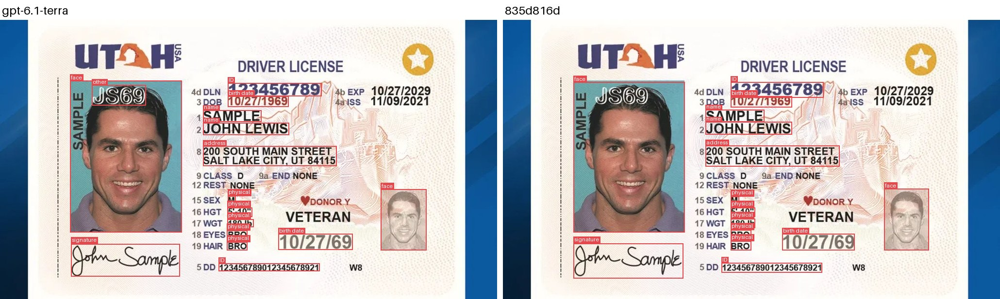

# PII redactor

Find the personal information in a document image or a long chat with one model call: a box around each item in an
image, the character offsets of each item in a text. The redactor started out calling gpt-6.1-terra. Its calls went
through Sous, which kept each one with its answer and trained a small model to do the same job; now the same code
calls that model, for 88% less.

```python
import os
from openai import OpenAI
from pii import find_pii, redact_text

client = OpenAI(base_url="https://api.sousml.com/v1", api_key=os.environ["SOUS_API_KEY"])
model = os.environ["SOUS_MODEL"]  # your Sous model's id

find_pii(client, image="license.jpg", model=model)
# [{"type": "name", "value": "JANICE SAMPLE", "box": [412, 188, 538, 211]}, ...]   pixels

spans = find_pii(client, text=chat, model=model)
# [{"type": "email", "value": "ana.silva@example.com", "start": 1204, "end": 1225}, ...]
redact_text(chat, spans)
# "... the new one is [EMAIL]. ..."
```

This is the PII redactor in the [Sous sandbox](https://sandbox.sousml.com/models/835d816d): every call it learned
from, how each small model scored, and a playground to try it.



## Results

The redactor ran on the 47 documents and 80 chats in `samples/`, with its calls going through Sous to gpt-6.1-terra
(`samples/answers.jsonl` has every answer). Sous held back 25 of the calls (10 documents, 15 chats), trained four
small models on the other 102, and tested each on the 25:

| Model | Same answers as gpt-6.1-terra | Per 1,000 calls |
| --- | --- | --- |
| gpt-6.1-terra | | $5.55 |
| Qwen3-VL 2B | 65% | $0.43 |
| **Qwen3-VL 4B**, which Sous recommended | **83%** | **$0.65** |
| Qwen3-VL 8B | 84% | $1.76 |
| Qwen3-VL 8B, another recipe | 82% | $2.24 |

Items pair up in any order, and boxes count when they overlap by half or more. Sous recommended the 4B model: within
a point of the best, it finished every test reply, and it's faster and cheaper than both 8B models. Training cost
$5.02.

With the 4B model answering the redactor's calls, `score.py` on the 12 documents and 20 chats in `samples/test`,
which Sous never saw:

| | gpt-6.1-terra | The 4B model |
| --- | --- | --- |
| **Chats** (880 pieces of PII) | | |
| PII hidden | 100% | 98.8% |
| Of what it hid, the share that is PII | 100% | 99.2% |
| PII characters hidden | 100% | 99.4% |
| Seconds per chat (median) | 8.3 | 15.9 |
| **Documents** | | |
| Items found per document | 10.7 | 12.5 |
| gpt-6.1-terra's boxes it also drew | | 73.4% |
| Its boxes gpt-6.1-terra also drew | | 62.7% |
| Seconds per document (median) | 10.3 | 10.5 |

What to expect:

- **Chats are nearly as good as gpt-6.1-terra; documents aren't yet.** The 4B model draws about three in four of
  gpt-6.1-terra's boxes, and some of its own. It learned from 37 documents: more of the kinds your app sees close
  the gap. Keep calling it through Sous, and train again.
- **It costs 88% less**: $0.65 per 1,000 calls, against $5.55.
- **Speed:** with 8 calls at once on its one GPU, the 4B model is as fast as gpt-6.1-terra on documents and takes
  about twice as long on long chats. Its server sleeps after 2 minutes without calls, and the next call wakes it,
  which takes about 3 minutes; gpt-6.1-terra answers in the meantime.
- **Agreement isn't recall.** It says how closely the model matches gpt-6.1-terra, not whether it caught everything.
  `python redact.py card.jpg --review` outlines what it found, so a person can check documents that matter.

## What's here

| File | What it does |
| --- | --- |
| `pii.py` | The redactor: its instructions and JSON schema, `find_pii()`, `redact_text()`, and `redact_image()` |
| `collect.py` | Runs the redactor on the samples with its calls going through Sous, as your app would, so Sous learns from them |
| `score.py` | Scores gpt-6.1-terra and the model Sous trained on the samples Sous never saw |
| `redact.py` | Redacts one image or text file from the command line |
| `make_conversations.py` | Writes the sample chats, with where each piece of PII is in them |
| `samples/` | 47 specimen ID documents and 80 chats to learn from, 12 documents and 20 chats held out for scoring ([sources](samples/SOURCES.md)), and gpt-6.1-terra's answers |

## Run it

1. Install the requirements, from the top of this repo:

   ```sh
   pip install -r requirements.txt
   ```

   To try the redactor before you have a Sous account, run it straight against OpenAI:
   `OPENAI_API_KEY=sk-... python redact.py samples/test/chat.txt`.

2. Make a Sous model that learns from the redactor's calls, with gpt-6.1-terra as its teacher. In Sous, **New
   model**; or with your Sous API key:

   ```sh
   curl -X POST https://api.sousml.com/v1/tasks -H "Authorization: Bearer $SOUS_API_KEY" \
     -H "content-type: application/json" \
     -d '{"name": "PII redactor", "teacher": "gpt-6.1-terra", "provider": "openai"}'
   ```

   The model's `id` is in the reply and on its page.

3. Run the redactor on the samples. Sous passes each call to gpt-6.1-terra, keeps it, and charges what OpenAI lists
   the call at, about a dollar for all 127.

   ```sh
   export SOUS_API_KEY=hk_... SOUS_MODEL=<the model's id>
   python collect.py
   ```

4. Train. Sous starts on its own a few minutes after `collect.py` sends its last call, so the whole batch trains
   together. To start sooner, **Train now** on the model's page, or

   ```sh
   curl -X POST "https://api.sousml.com/v1/tasks/$SOUS_MODEL/start" -H "Authorization: Bearer $SOUS_API_KEY"
   ```

   Sous trains a few small models on gpt-6.1-terra's answers, tests each on the calls it held back, and recommends
   one. The model's page shows how they compare and what each costs.

5. Score one of them on the held-out samples before you switch to it (`c2` is one of the small models on the page).
   The gpt-6.1-terra column calls OpenAI with your `OPENAI_API_KEY`; `--only sous` leaves it out.

   ```sh
   python score.py --sous-model "$SOUS_MODEL:c2"
   ```

6. Switch: **Switch** beside the model you want on the model's page. From then on the same calls go to the small
   model, with no change to your code.

   ```sh
   python redact.py samples/test/documents/utah-driver-license.jpg --review
   python redact.py samples/test/chat.txt
   ```

## How it works

**One call, either input.** `find_pii` sends the image or the text with one set of instructions and a strict JSON
schema: for an image, each item is a `type`, the `value` as written, and a `box`; for a text, a `type` and a `value`.
It returns boxes in the image's pixels, and `start` and `end` offsets in the text.

**Boxes** come back from 0 to 1000 across the image's width and height, so they don't depend on its size, and
`find_pii` turns them into the image's pixels. Images are sent at most 1536 pixels on their longer side. The image
schema requires a box on every item, so the model can't leave one out.

**Offsets** come from `find_pii`, not the model. Models don't count characters reliably: asked for `start` and `end`
on the held-out chats, gpt-6.1-terra had them right for 31% of what it found, though it found every piece of PII.
Models copy text well, though, so the model lists each value exactly as written, in the order they appear, and
`find_pii` finds each one in the text: the next place it's written after the item before. The offsets are exact by
construction, and leaving them out makes replies much shorter: with offsets in the schema, gpt-6.1-terra took about
70 seconds a chat instead of 8, and cost four times as much. `redact_text` also hides any other place a found value
is written, in case the model listed a repeat once.

**What counts as PII** is spelled out in `INSTRUCTIONS` in `pii.py`: names, birth dates, addresses, ID and account
numbers, phones, emails, card and bank numbers, credentials, IP addresses, and on documents faces, signatures, machine
readable zones, and physical descriptions. Order, ticket, and claim numbers, amounts, other dates, and the last 4
digits of a card aren't. Change it to your own rules; the model Sous trains learns whatever gpt-6.1-terra does with
them.

## About the samples

The documents are specimens issuers publish to show what their cards look like: sample names, sample numbers, and
models' photos, with no real person's information ([sources](samples/SOURCES.md)). The chats are made up by
`make_conversations.py`, which keeps every value fake: phone numbers in 555-0100 to 555-0199, example.com emails, IP
addresses from the documentation ranges, SSNs starting with 9, and test card numbers. It also writes where each piece
of PII is, which is how `score.py` scores the chats without anyone labeling them.

`samples/answers.jsonl` has one line per call Sous learned from: the sample (`documents/<name>.jpg`, or
`conversations.jsonl#<id>`) and what gpt-6.1-terra found in it, as `find_pii` returns it.
